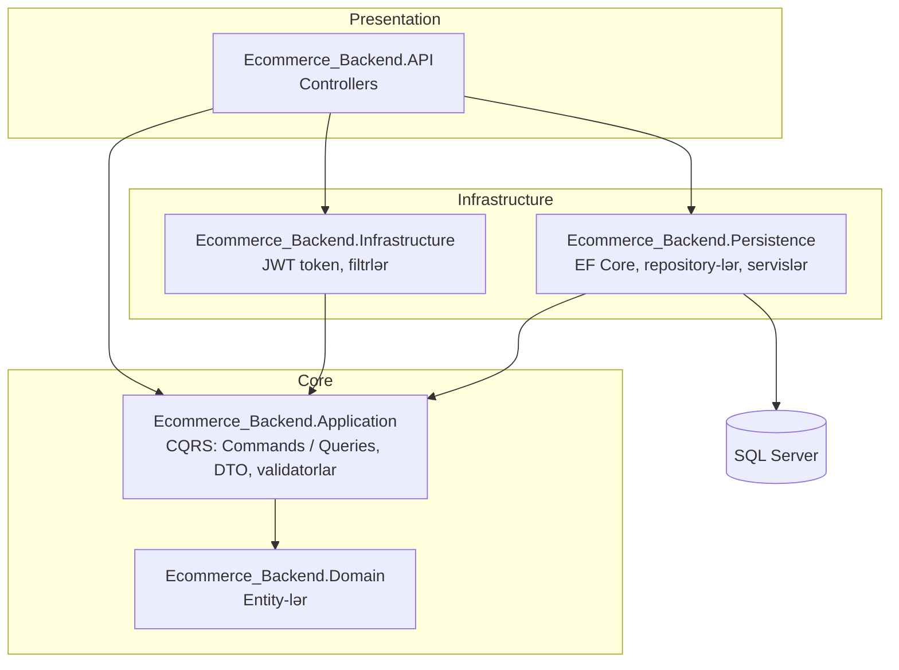
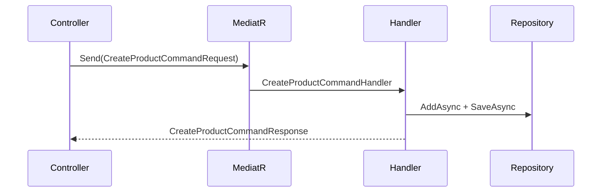

<div align="center">

# Mini E-Commerce Backend

**Onion Architecture və CQRS ilə qurulmuş e-ticarət backend-i**


</div>

---

## 📌 Haqqında

**Mini E-Commerce** — e-ticarət tətbiqi üçün ASP.NET Core 8 Web API backend-idir.
Layihənin məqsədi **Onion Architecture**, **CQRS** (MediatR ilə) və **Repository Pattern** kimi yanaşmaları real nümunədə tətbiq etməkdir.

---

## ✨ Xüsusiyyətlər

- 🔐 **JWT autentifikasiya** — qeydiyyat və giriş
- 🌐 **Google ilə giriş** (Google ID token yoxlaması)
- 👤 **ASP.NET Core Identity** — istifadəçi və rollar
- 🛍️ **Məhsul CRUD** — yaratmaq, yeniləmək, silmək, siyahı və ID ilə oxumaq
- 📑 **Pagination** — məhsul siyahısında səhifələmə
- ✅ **FluentValidation** — sorğu validasiyası
- 🗂️ **Generic Repository** — ayrıca Read/Write repository-ləri (Product, Order, Customer)
- 📘 **Swagger** — API sənədləri

---

## 🏗️ Arxitektura: Onion

Asılılıqlar **içəriyə doğru** yönəlir: mərkəzdə Domain, ən xaricdə API.



### CQRS axını



| Tip | Nümunələr |
|---|---|
| **Commands** (yazma) | `CreateUser`, `LoginUser`, `GoogleLogin`, `CreateProduct`, `UpdateProduct`, `RemoveProduct` |
| **Queries** (oxuma) | `GetAllProducts`, `GetByIdProduct` |

---

## 🧰 Texnologiyalar

| Sahə | Texnologiya |
|---|---|
| Platforma | .NET 8, ASP.NET Core Web API |
| Arxitektura | Onion Architecture, CQRS, Repository Pattern |
| Verilənlər bazası | SQL Server, Entity Framework Core |
| Mediator | MediatR |
| Validasiya | FluentValidation |
| Autentifikasiya | ASP.NET Core Identity, JWT Bearer, Google Auth |
| API sənədləri | Swagger (Swashbuckle) |

---

## 📁 Layihə strukturu

```text
Mini_Ecommerce/
├── Core/
│   ├── Ecommerce_Backend.Domain/           Entity-lər (Product, Order, Customer, AppUser...)
│   └── Ecommerce_Backend.Application/      CQRS feature-ləri, DTO, interfeyslər, validatorlar
├── Infrastructure/
│   ├── Ecommerce_Backend.Infrastructure/   JWT token handler, filtrlər
│   └── Ecommerce_Backend.Persistence/      DbContext, repository-lər, servislər
└── Presentation/
    └── Ecommerce_Backend.API/              Controllers, Program.cs
```

---

## 🔌 API endpoint-ləri

| Controller | Əməliyyatlar |
|---|---|
| `UsersController` | İstifadəçi qeydiyyatı |
| `AuthsController` | Giriş, Google ilə giriş (`google-login`) |
| `ProductsController` | `GET` (pagination ilə), `GET {id}`, `POST`, `PUT`, `DELETE` |

Bütün endpoint-ləri Swagger-də görmək olar.

---

## 🚀 İşə salma

### Tələblər

- [.NET 8 SDK](https://dotnet.microsoft.com/download/dotnet/8.0)
- SQL Server

### Addımlar

```bash
git clone https://github.com/alesskeroov/Mini_Ecommerce.git
cd Mini_Ecommerce
```

1. `Presentation/Ecommerce_Backend.API/appsettings.json` faylında connection string və JWT ayarlarını öz mühitinə uyğunlaşdır
2. Bazanı yarat:

```bash
dotnet ef database update --project Infrastructure/Ecommerce_Backend.Persistence --startup-project Presentation/Ecommerce_Backend.API
```

3. API-ni işə sal:

```bash
dotnet run --project Presentation/Ecommerce_Backend.API
```

4. Swagger: `https://localhost:<port>/swagger`

---

<div align="center">
  <sub>© 2025, Rəvan Ələsgərov</sub>
</div>
